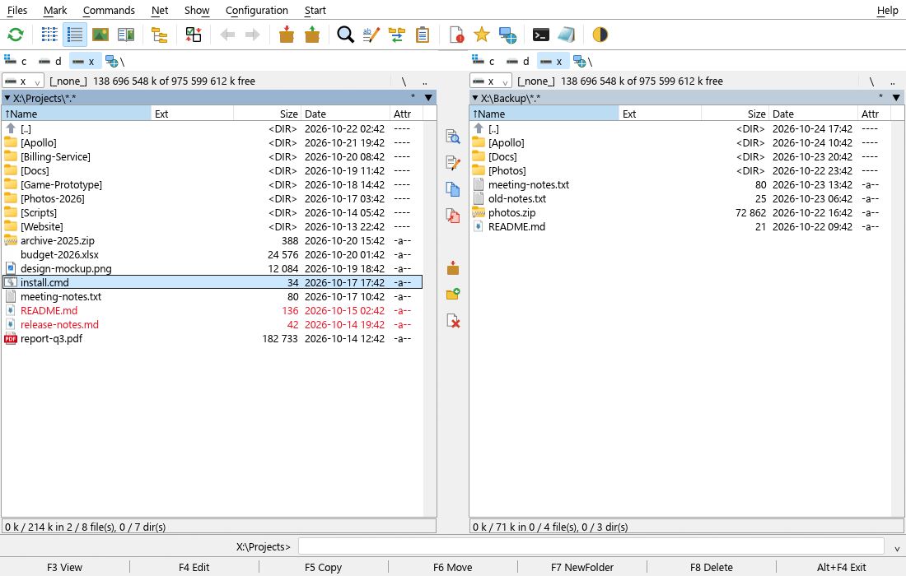
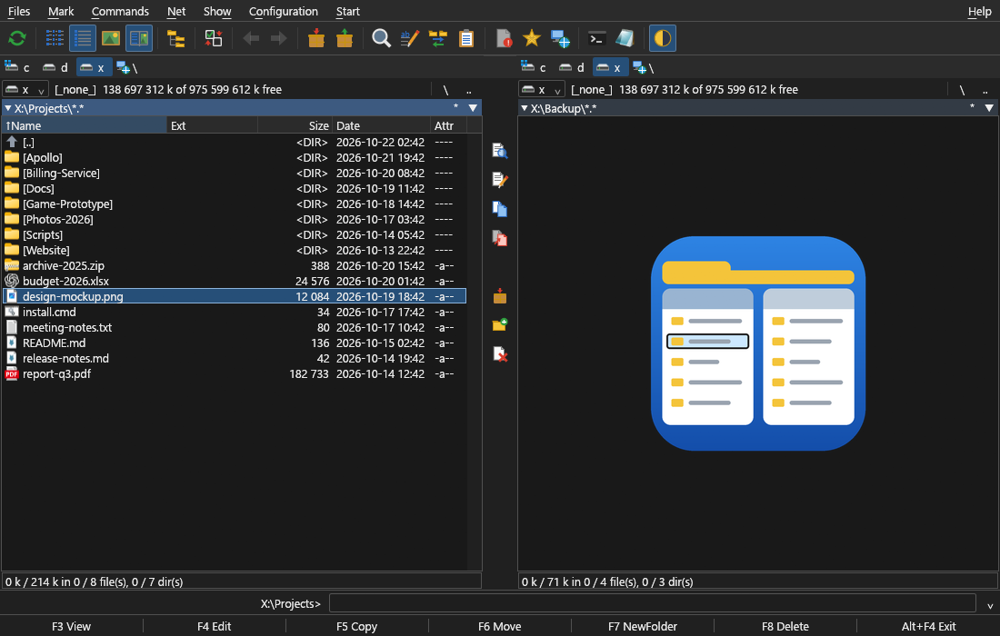
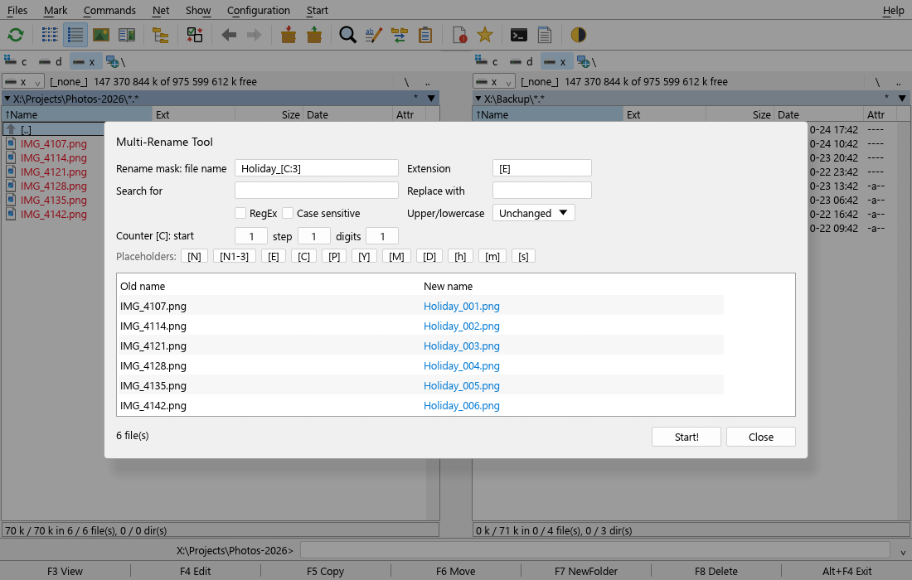
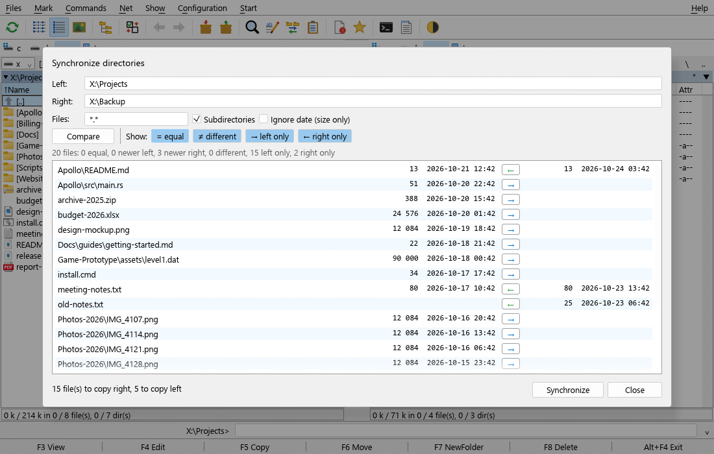

<div align="center">


# MCommander

**A fast, keyboard-driven dual-pane file manager for Windows, written in Rust.**

Total Commander's workflow and key layout, rebuilt from scratch, with light and dark themes.


</div>





## Why MCommander?

If your hands already know <kbd>F5</kbd> copy, <kbd>F6</kbd> move, <kbd>Tab</kbd> and <kbd>Num +</kbd>, MCommander will feel at home on the first keystroke. It reads your existing Total Commander `wincmd.ini` on first start, so your directory hotlist, command-line history, panel paths, sort order, quick-search style and saved FTP connections come along.

- **Two panels with folder tabs**: full, brief and thumbnail views (Explorer's previews of photos, videos and documents), sortable and resizable columns, history, hotlist and drive buttons. Click a folder in the path line above a panel to jump there, or click beside it to type or paste a path: a folder, a file, a folder inside an archive or an `sftp://` / `ftp://` URL.
- **The Total Commander keyboard layout**: F-keys, Num +/-/\*, Ctrl+Alt quick search (or letter-only, as in TC), Ctrl+Left/Right, Ctrl+U and the rest. Press <kbd>F1</kbd> in the app for the full list.
- **The Total Commander mouse**: the right button selects files (they turn red), dragging with it selects several, and holding it for half a second opens the context menu. Explorer-style selection with the left button is an option.
- **Background file operations**: copy, move, delete (recycle bin or permanent) and rename on the fly with masks such as `*.bak`. They show progress, speed, cancel and an overwrite dialog (overwrite / skip / older / auto-rename, each with an "all" variant).
- **Archives open like folders**: ZIP, 7z, RAR and tar (plain, .gz, .xz, .bz2, .zst). Browse with Enter, copy files out, unpack (Alt+F9) and test. You can also pack (Alt+F5) to ZIP, 7z or tar.gz/xz/bz2. ZIP archives can additionally be edited in place: copy files in, delete inside. Everything runs in-process with exact Unicode names, without needing 7-Zip.
- **FTP, FTPS and SFTP**: <kbd>Ctrl</kbd>+<kbd>F</kbd> opens your saved connections, <kbd>Ctrl</kbd>+<kbd>N</kbd> connects to a host or URL such as `sftp://me@nas/home/me`, and <kbd>Ctrl</kbd>+<kbd>Shift</kbd>+<kbd>F</kbd> disconnects. A server shows up in a panel like a folder: copy and move in both directions (whole folder trees, with progress and the overwrite dialog), rename, create folders, delete, view (F3) and edit (F4; the file is uploaded again when you save it). Transfers use their own connection, so you can keep browsing. Passwords are kept in the Windows Credential Manager. SFTP host keys are checked against `known_hosts` (MCommander's own and `~/.ssh/known_hosts`), and FTPS certificates against the Windows certificate store, and you are asked before an unknown key or a self-signed certificate is trusted. SFTP logs in with your `~/.ssh` keys, a key file or a password. FTP supports passive and active mode, MLSD and Unix/Windows listings.
- **Lister (F3)**: text with encoding detection, wrap and search, plus hex for any size and an image view. N/P step to the next or previous file.
- **Find files (Alt+F7)**: name masks with exclusions, content search (UTF-8, UTF-16, ANSI, regex). Results can go to the file or be fed into a panel.
- **Multi-Rename Tool (Ctrl+M)**: `[N]`, `[E]`, `[C]`, `[P]` and date placeholders, search and replace with regex, case conversion and a live preview.
- **Synchronize directories**: recursive compare by size and date, with a direction you can change per file and a one-click sync.
- **Button bars you can change**: the bar under the menu and the vertical bar between the panels use Total Commander's `.bar` format, so your TC bars come along, sub-bars included. A button can run internal commands (`cm_Copy`, also several in a row), `cd` to a folder, start a program with TC's parameters (`%P%N`, `%S`, `%T`, list files with `%L`, `?` to edit them first), or open another bar as a menu. Right-click a button to change or delete it, drop files on a button to open them with its program, and drop a program on an empty spot to add it. MCommander draws its own pictures for TC's icon library and shows the real icons of programs.
- **Windows integration**: Explorer's own context menu (right-click beside the files, on **[..]** or on the path line for the folder's menu with **New**), shell icons, property sheets, file clipboard compatible with Explorer, and drag & drop between panels, from Explorer, and out to Explorer and other apps. Folders refresh automatically when they change, and network shares and removable drives are read in the background, so a slow share never freezes the window.
- **Light, dark or follow Windows**, including a dark title bar, switchable at runtime.

<table>
<tr>
<td></td>
<td></td>
</tr>
</table>

## Getting started

### Download

Grab `MCommander-<version>-win-x64.zip` from the [latest release](https://github.com/Mad-Mange/MCommander/releases/latest), unzip it and run `MCommander.exe`. It is a single self-contained file for Windows 10/11 x64, with nothing to install. The binary is not code-signed, so SmartScreen may ask once.

### Build from source

#### Requirements

- Windows 10 or 11 (x64)
- [Rust](https://rustup.rs/) stable with the MSVC toolchain
- The Windows SDK (for `rc.exe`, which embeds the icon and manifest); it comes with Visual Studio Build Tools

#### Build and run

```powershell
git clone https://github.com/Mad-Mange/MCommander.git
cd MCommander
cargo build --release
.\target\release\mcommander.exe
```

The release build is a single self-contained `mcommander.exe`; copy it anywhere you like.

### Command line

| Option | Meaning |
|---|---|
| `mcommander.exe [left] [right]` | Open the given directories in the left and right panels |
| `/L=path`, `/R=path` | Same, Total Commander style |
| `/I=file.ini` | Use another settings file |
| `--size=WxH` | Initial window size |
| `--keys=...` | Scripted input for UI tests (see below) |

## Keyboard essentials

| Key | Action | Key | Action |
|---|---|---|---|
| <kbd>F3</kbd> | View (Lister) | <kbd>Tab</kbd> | Switch panel |
| <kbd>F4</kbd> | Edit | <kbd>Insert</kbd> / <kbd>Space</kbd> | Select (Space counts directory size) |
| <kbd>F5</kbd> | Copy | <kbd>Num +</kbd> / <kbd>Num -</kbd> / <kbd>Num \*</kbd> | Select group / unselect / invert |
| <kbd>F6</kbd> | Move / rename | <kbd>Ctrl</kbd>+<kbd>D</kbd> | Directory hotlist |
| <kbd>Shift</kbd>+<kbd>F6</kbd> | Rename in place | <kbd>Alt</kbd>+<kbd>F7</kbd> | Find files |
| <kbd>F7</kbd> | New folder | <kbd>Ctrl</kbd>+<kbd>M</kbd> | Multi-Rename Tool |
| <kbd>F8</kbd> / <kbd>Del</kbd> | Delete (Shift: permanently) | <kbd>Ctrl</kbd>+<kbd>T</kbd> / <kbd>Ctrl</kbd>+<kbd>W</kbd> | New tab / close tab |
| <kbd>Alt</kbd>+<kbd>F5</kbd> / <kbd>Alt</kbd>+<kbd>F9</kbd> | Pack / unpack | <kbd>Ctrl</kbd>+<kbd>Q</kbd> | Quick view panel |
| <kbd>Ctrl</kbd>+<kbd>F1</kbd> / <kbd>F2</kbd> | Brief / full view | <kbd>Ctrl</kbd>+<kbd>Shift</kbd>+<kbd>F1</kbd> | Thumbnails view |
| <kbd>Alt</kbd>+<kbd>F1</kbd> / <kbd>F2</kbd> | Choose drive | <kbd>Ctrl</kbd>+<kbd>U</kbd> | Swap panels |
| <kbd>Alt</kbd>+<kbd>F10</kbd> | Directory tree | <kbd>Ctrl</kbd>+<kbd>B</kbd> | Branch view (all subfolder files) |
| <kbd>F9</kbd> / <kbd>F10</kbd> | Main menu (also <kbd>Alt</kbd>+underlined letter) | <kbd>Shift</kbd>+<kbd>F10</kbd> | Explorer context menu |
| <kbd>Alt</kbd>+<kbd>Left</kbd> / <kbd>Right</kbd> | Back / forward | <kbd>Ctrl</kbd>+<kbd>C</kbd> / <kbd>X</kbd> / <kbd>V</kbd> | File clipboard (works with Explorer) |
| <kbd>Ctrl</kbd>+<kbd>F</kbd> | Connect to a saved FTP/SFTP server | <kbd>Ctrl</kbd>+<kbd>N</kbd> / <kbd>Ctrl</kbd>+<kbd>Shift</kbd>+<kbd>F</kbd> | New connection by URL / disconnect |

Typing goes to the command line at the bottom (`cd`, `md`, `rd` and drive changes run internally; anything else starts in the current folder; launchers of Windows programs such as VS Code's `code .` start without a console window), unless you choose a letter-only quick search mode in the options, as in Total Commander.

## Settings

Settings live in `%APPDATA%\MCommander\mcommander.ini`. On the very first start MCommander looks for Total Commander's `wincmd.ini` (in `%COMMANDER_INI%`, `%APPDATA%\GHISLER` or the TC folder) and imports the parts that map one-to-one, plus the connections in `wcx_ftp.ini` (without passwords, which TC only scrambles). You can import again at any time with **Configuration > Import Total Commander Settings**, or **Import from TC** in the connection dialog. MCommander never writes to Total Commander's files.

Saved FTP/SFTP connections are part of `mcommander.ini`; their passwords are stored in the Windows Credential Manager (as `MCommander:ftp://user@host`). Trusted SSH host keys and accepted FTPS certificates are kept next to the settings in `known_hosts` and `trusted_certs`.

**Configuration > Options** covers the theme (light, dark or follow Windows), font size, which window parts are visible, quick search style, mouse selection mode, recycle bin, delete confirmation, and the editor and terminal commands.

The button bars are kept next to the settings as `default.bar` (under the menu) and `vertical.bar` (between the panels), in Total Commander's format. Until you change a bar, MCommander uses its built-in one. **Configuration > Button Bar...** and **Vertical Button Bar...** open the editor, as does a right-click on a bar. The import copies Total Commander's bars and fills in `%COMMANDER_PATH%`; buttons with commands MCommander doesn't have are shown greyed out.

## How it is built

MCommander is about 20,000 lines of Rust (tests included) in one binary crate:

| Module | Responsibility |
|---|---|
| `app.rs`, `commands.rs` | Application state, input routing and the command dispatcher (the equivalent of TC's `cm_*` commands) |
| `ui.rs`, `dialogs.rs`, `paint_icons.rs`, `theme.rs` | Custom-drawn panels with egui, modal dialogs, vector toolbar icons and the light/dark palettes |
| `panel.rs`, `vfs.rs` | Tabs, cursor, selection and history; local, archive, server and search-result locations; sorting |
| `archive.rs` | ZIP (read/write), 7z, tar.* (read/create) and RAR (read) behind one entry iterator |
| `ops/` | Copy/move/delete/pack jobs on worker threads (`CopyFileExW` with progress and cancel), uploads, downloads and server-side operations |
| `remote/`, `remote_ui.rs` | FTP/FTPS (suppaftp + rustls) and SFTP (russh) behind one blocking interface; host key and certificate trust, saved connections, Credential Manager, the connect dialogs |
| `viewer.rs`, `search.rs`, `rename.rs`, `sync.rs`, `tree.rs` | Lister, Find Files, Multi-Rename, Synchronize, CD tree |
| `win.rs`, `icons.rs`, `watch.rs` | Win32: drives, shell execution, recycle bin, clipboard, context menu, icons, keyboard hook, change notifications |
| `buttonbar.rs`, `bar_ui.rs`, `params.rs` | Button bars in TC's `.bar` format, their editor, and the `%P%N` parameter placeholders |
| `config.rs`, `ini.rs` | Settings and the `wincmd.ini` import |

The file lists are drawn row by row on egui's painter, so only visible rows cost anything. A directory with 5,000 files scrolls smoothly, and the app uses no CPU while idle.

## Testing

```powershell
cargo test                                         # unit and integration tests (real temp folders, archives and local FTP/FTPS/SFTP servers)
powershell -File scripts\make_screenshots.ps1      # regenerates the screenshots above via scripted UI input
cargo run --example test_servers                   # local FTP (2121), FTPS (2122) and SFTP (2222, demo/demo) servers to try the client
```

The app accepts `--keys=` scripts for end-to-end UI checks. The steps are comma separated: key names such as `F5`, `Ctrl+F3` or `Alt+Shift+F9`, plus `Text:abc`, `Click:x;y`, `NumPlus`, `CtrlV`, `Wait:300`, `Shot:file.png` (main window), `ShotChild:file.png` (Lister), `ShotSearch:file.png` and `Exit`.

## Not (yet) included

Coming from Total Commander, you will miss plugins (WCX/WFX/WLX/WDX), custom columns, user-defined `em_` commands, a configurable Start menu, multi-file property sheets, and updating 7z/tar archives in place (they are read-only; only ZIP can be modified). RAR archives can be read but not created. The FTP client has no proxy/firewall settings, direct server-to-server transfers (FXP) or resuming of interrupted transfers yet, and SFTP does not use Pageant or the SSH agent. Pull requests are welcome.

## About this project

MCommander is an independent, clean-room reimplementation. Its behaviour follows Total Commander's public documentation and keyboard reference; no Total Commander code, binaries, icons or artwork are included or derived. The icons are drawn by the app itself.

*Total Commander* is a trademark of Christian Ghisler / Ghisler Software GmbH. MCommander is not affiliated with or endorsed by Ghisler Software. If you like this way of working, consider [buying Total Commander](https://www.ghisler.com/).

## License

[MIT](LICENSE)
